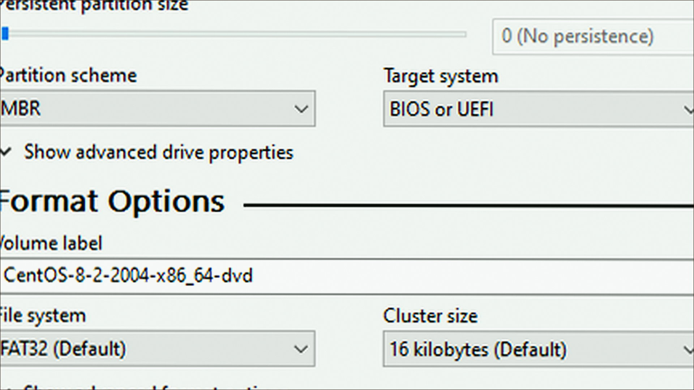
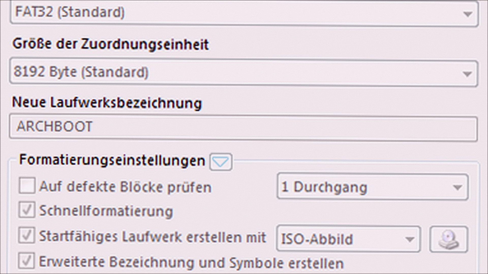
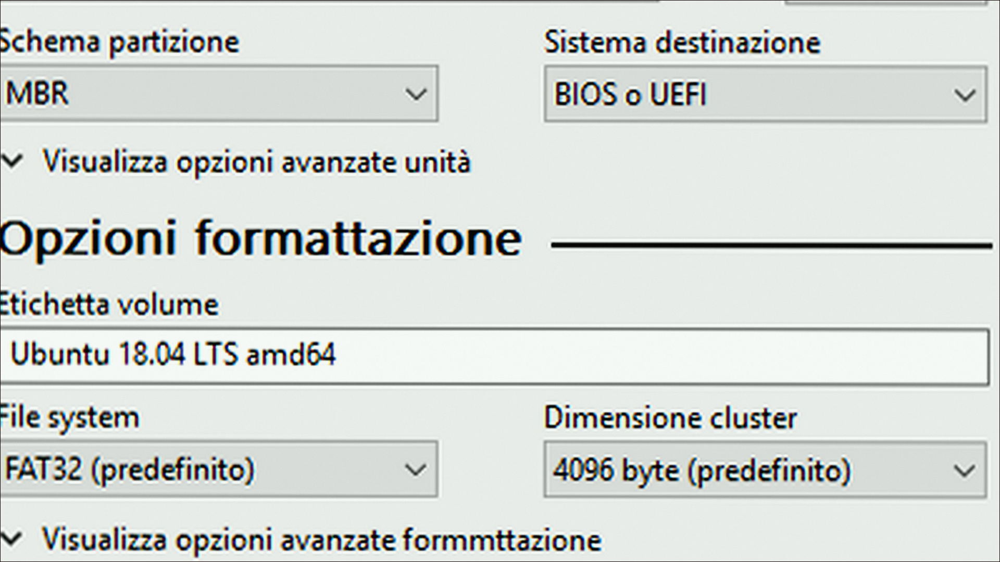

# Windows notes: Rufus

**Pete Batard** · 4.15 · 3.7 MB · System catalog

[Open card](https://moggydayprogram.com/programs/rufus) · [English](https://moggydayprogram.com/en/programs/rufus) · [GitHub Pages](https://meshherbalistknow.github.io/rufus-windows/?lang=en)

  
  
  

Загрузочная флешка из ISO за пару минут. Бесплатно, портативен.

Rufus on Windows 10/11 x64. 3.7 MB. Requirements, screenshots, MoggyDay Launcher.

Get it from the catalog card, not from this repository.

| Field | Value |
| --- | --- |
| Build | 4.15 (x64 + x86) |
| OS | Windows 10/11 x64 |
| Pages | https://meshherbalistknow.github.io/rufus-windows/ |

- [UltraISO](https://moggydayprogram.com/programs/ultraiso)
- [PowerISO](https://moggydayprogram.com/programs/poweriso)
